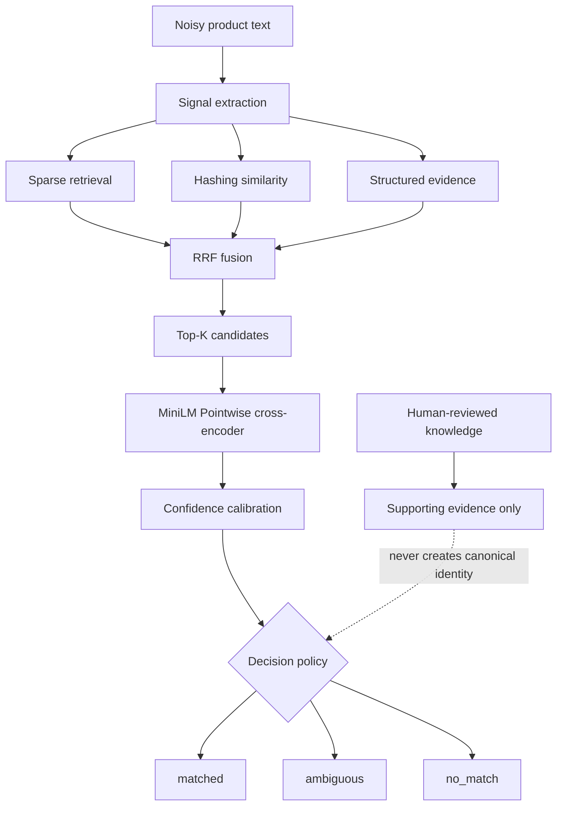

# Product Variant Resolver

## Confidence-Aware Product Entity Resolution & Learning-to-Rank

Product Variant Resolver maps noisy marketplace and search-result text to exact product releases.
It combines high-recall candidate retrieval, a MiniLM cross-encoder, and calibrated abstention
instead of forcing every query to a match.

The project is a portfolio-grade AI engineering system, not a deployed marketplace service or a
manufacturer-certified catalog. It was motivated by identity errors in an earlier livestream
price-checking workflow, but this repository is a standalone text/evidence-to-identity resolver.

> **Current portfolio headline:** on a paired Image/Lens and Shopping benchmark, Pointwise
> cross-encoder reranking improved exact-release Top-1 from **55% to 64%** across 100 source
> observations from 50 held-out product identities.

[Architecture](#architecture) · [Results](#current-best-evidence) ·
[AI/ML components](#aiml-components) · [Code tour](docs/CODE-TOUR.md) ·
[Limitations](docs/LIMITATIONS.md) · [Technical docs](docs/README.md)

## Why this problem is hard

Marketplace titles can omit the year, use abbreviations, contain an incorrect color, mix seller lot
numbers with collector numbers, or describe several releases that share the same casting. Finding
the right casting is easier than identifying the exact release. A useful resolver must therefore
rank close siblings and be able to say `ambiguous` or `no_match` when the evidence is insufficient.

## Architecture



The runtime uses **authority-separated dual-corpus retrieval**:

- The catalog corpus is the only source allowed to produce a canonical UUID.
- Human Knowledge provides review and explanation evidence but cannot promote or replace identity.

No LLM generates the final answer. The default `hashing-v1` representation is deterministic,
hashing-based similarity—not a learned neural embedding. PostgreSQL full-text search and pgvector
are available as optional retrieval/storage infrastructure; the dependency-light in-memory path
remains the default.

### Why these components?

| Component | Purpose |
|---|---|
| Sparse retrieval | Preserve exact names, identifiers, and lexical clues |
| Hashing similarity | Add dependency-light fuzzy similarity |
| Structured evidence | Compare year, series, collector number, and other release fields |
| Reciprocal Rank Fusion | Combine rankings without equating incompatible raw score scales |
| Pointwise cross-encoder | Model fine-grained query/candidate interaction |
| Calibration | Separate ranking score from probability of correctness |
| Abstention | Reduce confident wrong matches when support is weak |

See the [system overview](docs/architecture/system-overview.md) for the component boundaries and
[code tour](docs/CODE-TOUR.md) for the implementation path.

## AI/ML components

### Cross-encoder reranking

A revision-pinned MiniLM model jointly scores each noisy query and candidate release. It reranks an
unchanged Top-25 pool, which isolates ranking quality from candidate-generation recall.

### Learning-to-rank experiments

The repository compares a Pointwise cross-encoder, a candidate-set Listwise reranker, and
RankNet-style pairwise domain adaptation. Model selection follows frozen development and test
boundaries; a more complex model is retained as a negative result when it fails its preregistered
gate.

### Hard-negative mining

Training pairs emphasize difficult same-casting, wrong-release siblings and only admit conflicts
supported by fields present in the query. Unsupported examples are held rather than forced into a
label.

### Confidence calibration

Logistic, isotonic, and temperature calibration experiments measure Brier score, expected
calibration error, and risk/coverage. Ranking logits are never presented as calibrated probability.
Current calibration evidence is conservative and does not qualify the neural policy for runtime.

### Inference optimization

Float32 ONNX export preserved all frozen Top-25 orderings within a maximum logit delta of
`1.48e-05` and reduced the measured one-thread CPU p95 used by the domain-ranker experiment. The
ONNX path is reproducible experiment infrastructure, not the FastAPI default.

## Current best evidence

The primary benchmark contains 150 catalog-backed identities, each represented by one Image/Lens
and one Shopping result. The split is grouped by identity: 100 identities were used for development
and 50 were opened once for final evaluation. The two source records for each final identity produce
100 observations; they are not 100 independent products.

| Metric (`n=100` observations / 50 identities) | RRF | Pointwise cross-encoder |
|---|---:|---:|
| Exact-release Top-1 | 55% | **64%** |
| Casting Top-1 | 86% | **95%** |
| MRR@10 | 0.722 | **0.792** |
| Recall@25 | 99% | 99% |

The nine-point exact-release improvement is the portfolio headline. It is a ranking result, not
runtime-policy accuracy: the evaluated Pointwise model and calibration policy remain offline.
Image and Shopping behavior, the one-point Recall@10 trade-off, historical benchmarks, calibration,
negative domain-adaptation results, and ONNX measurements are organized in
[Results](docs/RESULTS.md).

## Engineering decisions

1. **Preserve evidence instead of over-cleaning.** Raw search-result text outperformed aggressive
   cleaning because identifiers and release clues were otherwise lost.
2. **Separate retrieval from ranking.** Recall@25 showed that the correct release was usually in the
   pool; the measured bottleneck was candidate ordering.
3. **Do not equate relevance with correctness confidence.** Cross-encoder scores rank candidates;
   a separate calibrator and policy decide whether to match or abstain.
4. **Reject marginal model improvements.** Domain-finetuned checkpoints were not selected when
   they failed preregistered quality gates, even when one metric improved slightly.

## Data and authority boundary

- Catalog: 1,763 third-party community release observations; not Mattel/global truth.
- Primary benchmark: 150 identities / 300 paired source records; search-result-derived, not organic
  marketplace traffic.
- Exact authority subset: 20 owner-reviewed releases across seven families relative to one frozen
  community revision; unsupported color and edition remain null.
- API outcomes: `matched`, `ambiguous`, or `no_match`; only `matched` returns a canonical UUID.

Historical blocked audits and `winner: null` experiments are preserved for reproducibility, but are
not required reading for the portfolio overview. See [Known limitations](docs/LIMITATIONS.md),
[artifact policy](docs/ARTIFACT-POLICY.md), and the [historical archive](docs/archive/README.md).

## Run locally

Requires Python 3.12.

```bash
python3.12 -m venv .venv
.venv/bin/pip install -e '.[dev]'
PYTHONPATH=src .venv/bin/uvicorn product_variant_resolver.api:app --reload
```

Resolve one noisy title:

```bash
curl -s http://127.0.0.1:8000/resolve \
  -H 'Content-Type: application/json' \
  -d '{"title":"Hot Wheels Subaru BRZ JBB55"}'
```

Health and readiness are exposed at `GET /health`. Optional PostgreSQL and ML dependencies are
documented through `pyproject.toml` extras; local secrets belong in `.env`, which is ignored.

## Tech stack

Python 3.12 · FastAPI · Pydantic · PyTorch / Sentence Transformers · ONNX Runtime · PostgreSQL /
pgvector · Pytest · Ruff · MyPy

## Start a deeper review

| Topic | Start here |
|---|---|
| Documentation map | [docs/README.md](docs/README.md) |
| Architecture and component rationale | [docs/architecture/system-overview.md](docs/architecture/system-overview.md) |
| Current and historical results | [docs/RESULTS.md](docs/RESULTS.md) |
| Important implementation files | [docs/CODE-TOUR.md](docs/CODE-TOUR.md) |
| Resume and interview claims | [docs/PORTFOLIO-GUIDE.md](docs/PORTFOLIO-GUIDE.md) |
| Limitations and claim boundaries | [docs/LIMITATIONS.md](docs/LIMITATIONS.md) |
| Artifact retention | [docs/ARTIFACT-POLICY.md](docs/ARTIFACT-POLICY.md) |
| Frozen evidence and governance history | [docs/archive/README.md](docs/archive/README.md) |

## License and source note

Repository code and third-party data have different provenance. Review the source-specific
documentation before redistributing catalog material or model artifacts. This project does not
claim manufacturer certification or global product coverage.
