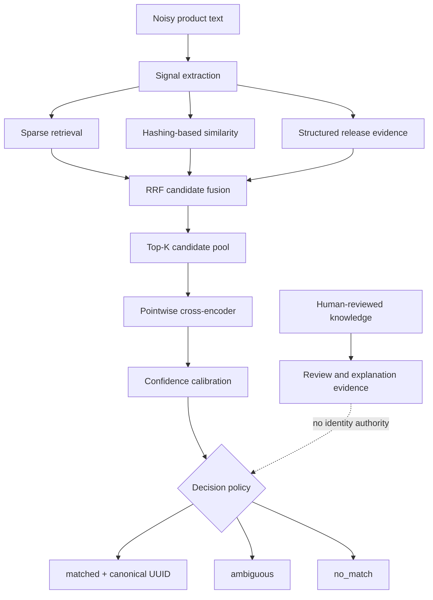

# System Overview

Product Variant Resolver is a confidence-aware entity-resolution system. It accepts noisy product
text, retrieves possible catalog releases, reranks them, and either returns an exact identity or
abstains.



## Why these components?

| Component | Why it exists | Boundary |
|---|---|---|
| Signal extraction | Normalizes text and extracts release clues | Does not decide identity |
| Sparse retrieval | Rewards exact lexical and identifier overlap | Candidate generation only |
| Hashing similarity | Adds deterministic fuzzy matching without model downloads | Non-neural baseline |
| Structured evidence | Compares year, series, color, and identifiers | Conflicts are soft evidence |
| RRF | Fuses rankings without comparing incompatible score scales | Preserves Top-K membership |
| Pointwise cross-encoder | Scores query/candidate meaning jointly | Offline unless a policy qualifies |
| Calibration | Estimates correctness separately from rank score | Bound to one frozen feature/model contract |
| Abstention | Avoids forced wrong matches | Returns `ambiguous` or `no_match` |

## Authority-separated dual-corpus retrieval

The catalog corpus and Human Knowledge corpus are searched separately because they have different
authority. Catalog candidates may lead to a canonical UUID after calibration and policy checks.
Human Knowledge contains reviewed or provisional evidence useful for explanation and adjudication;
it cannot create or override canonical identity.

This separation is a provenance and authorization boundary, not a generative RAG pipeline. No
language model composes the final answer.

## Active runtime versus experiments

The default FastAPI runtime uses in-memory sparse, deterministic hashing similarity, structured
evidence, RRF, calibration, and a three-state policy. PostgreSQL/pgvector, neural Pointwise and
Listwise rerankers, pairwise domain adaptation, and ONNX are implemented and evaluated behind
explicit selection boundaries. A measured experiment is not automatically an active runtime
component.

## Request boundary

```text
POST /resolve {title, debug?}
        |
        +--> matched    {canonical_uuid, confidence, ...}
        +--> ambiguous  {canonical_uuid: null, ...}
        +--> no_match   {canonical_uuid: null, ...}
```

Screenshot capture, reverse-image-search orchestration, and price lookup belong to the predecessor
workflow and remain outside this repository.

